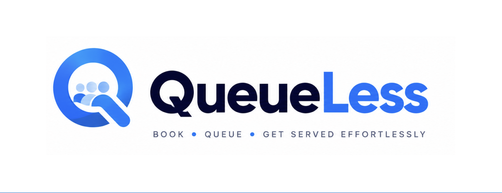

<div align="center">



# QueueLess - v1

### _Smart Virtual Queue Management & Real-Time Appointment Scheduling_

[](https://nodejs.org/)
[](https://expressjs.com/)
[](https://react.dev/)
[](https://vitejs.dev/)
[](https://www.mongodb.com/)
[](https://redis.io/)
[](https://socket.io/)
[](https://opensource.org/licenses/ISC)
[](https://github.com/sohamdey07/QueueLess-v1/pulls)

<p align="center">
  <strong>QueueLess</strong> is an end-to-end, real-time virtual queue and appointment scheduling platform designed to eliminate physical waiting lines in clinics, hospitals, banks, and service centers.
</p>

[Explore Features](#-key-features) • [Problem It Solves](#-what-problem-it-solves) • [Tech Stack](#-technology-stack) • [Installation Guide](#-getting-started--installation) • [Contributing](#-contributing)

</div>

---

## 📖 Background

Long physical queues have historically been one of the biggest friction points across healthcare and public services. Customers and patients often spend hours confined to crowded, stressful waiting rooms with zero visibility into when they will actually be attended to.

Meanwhile, administrative staff and desk attendants face disorganized walk-ins, unpredictable workload surges, and manual paper or ticket token machines that frequently break down and fail to provide analytics.

**QueueLess** was born from a simple mission: **Return valuable time back to people.** By digitizing the queue lifecycle from remote check-in to live counter dispatch, QueueLess turns chaotic waiting rooms into streamlined, modern, virtual waiting experiences.

---

## 🎯 What Problem QueueLess Solves

### 🚶 For Customers & Patients

- **No More Sitting in Cramped Waiting Rooms**: Join a virtual queue remotely from your smartphone or home before even arriving.
- **Live Real-Time Token Position**: Track your place in line and estimated wait time in real-time via WebSockets without having to refresh the page.
- **Advance Appointment Scheduling**: Select preferred specialists, services, and reserved time slots that fit your personal calendar.
- **Instant Alerts**: Receive timely notifications when your turn is approaching and when you are called to a designated counter.
- **Booking & History Management**: Easily view, track, or cancel active bookings and review past visit records.

### 🏢 For Clinics, Hospitals & Service Desks

- **Counter & Staff Orchestration**: Assign counters to active staff members, monitor service times, and call the next patient with a single click.
- **Dynamic Operating Hours & Capacity**: Set service availability, slot intervals, buffer times, and max queue capacities on a per-day basis.
- **Lobby TV Display Mode**: Dedicated big-screen public display view (`/display`) that projects live calling tokens and active counter numbers for physical lobby clarity.
- **Audit & Queue Transitions**: Comprehensive audit logs, transition timestamps, and wait-time statistics to analyze bottlenecks and optimize staff allocation.
- **Role-Based Security**: Segregated portals for Customers, Staff Officers, and System Administrators.

---

## ✨ Key Features

| Category                    | Highlights                                                                                                        |
| :-------------------------- | :---------------------------------------------------------------------------------------------------------------- |
| **Virtual Queue System**    | Instant token allocation, live WebSocket tracking, estimated wait countdown, remote cancel/leave queue.           |
| **Appointment Engine**      | Multi-service catalog, doctor/staff assignment, date-picker with live slot availability, conflict prevention.     |
| **Live Counter Management** | Dynamic desk status (Open/Serving/Closed), patient calling with audio/visual feedback, transfer between counters. |
| **Lobby TV Display**        | Full-screen broadcast interface designed for waiting hall TV monitors showing active tokens and counter calls.    |
| **Admin Control Center**    | Service creation, staff account provisioning, counter creation, daily schedule config, audit logs.                |
| **Responsive Mobile UI**    | Modern mobile drawer with background scroll-lock, high-contrast dark theme banners, touch-friendly components.    |
| **Robust Security**         | HTTP-only cookie JWT tokens, refresh token rotation, rate limiting, Helmet HTTP headers, Zod validation.          |

---

## 🛠 Technology Stack

### Frontend Architecture

- **Core**: [React 19](https://react.dev/), [Vite 8](https://vitejs.dev/) (lightning-fast HMR and bundle compilation)
- **Routing**: [React Router DOM v7](https://reactrouter.com/)
- **Real-time**: [Socket.io Client](https://socket.io/docs/v4/client-api/)
- **Icons & Animation**: [Lucide React](https://lucide.dev/), [Canvas Confetti](https://www.npmjs.com/package/canvas-confetti)
- **Styling**: Modern Vanilla CSS with CSS custom variables, custom mobile drawers, responsive layouts, and zero heavy CSS frameworks.

### Backend Architecture

- **Runtime & Framework**: [Node.js](https://nodejs.org/) (ES Modules), [Express 5](https://expressjs.com/)
- **Database**: [MongoDB](https://www.mongodb.com/) via [Mongoose ODM](https://mongoosejs.com/)
- **Job Queues & Cache**: [Redis](https://redis.io/) & [BullMQ](https://docs.bullmq.io/)
- **WebSockets**: [Socket.io](https://socket.io/) for bidirectional event streaming
- **Validation & Security**: [Zod](https://zod.dev/), [Helmet](https://helmetjs.github.io/), [Express Rate Limit](https://www.npmjs.com/package/express-rate-limit), [Bcryptjs](https://www.npmjs.com/package/bcryptjs), [JSONWebToken](https://jwt.io/)
- **Media & Notifications**: [ImageKit](https://imagekit.io/) for cloud assets, [Nodemailer](https://nodemailer.com/) with Google OAuth2 for transactional emails and OTPs
- **Logging**: [Pino](https://getpino.io/) & [Pino-Pretty](https://github.com/pinojs/pino-pretty)

---

## 🚀 Getting Started & Installation

Follow these steps to get QueueLess running locally on your machine.

### Prerequisites

Make sure you have installed:

- [Node.js](https://nodejs.org/) (v18.0.0 or higher recommended)
- [npm](https://www.npmjs.com/) (bundled with Node.js)
- [MongoDB](https://www.mongodb.com/try/download/community) running locally or a [MongoDB Atlas](https://www.mongodb.com/atlas) connection URI
- [Redis](https://redis.io/download/) server running locally (default: `localhost:6379`) or a cloud instance (e.g. Upstash)

---

### Step 1: Clone the Repository

```bash
git clone https://github.com/sohamdey07/QueueLess-v1.git
cd QueueLess-v1
```

---

### Step 2: Configure & Run Backend

1. **Navigate to the Backend directory:**

   ```bash
   cd Backend
   ```

2. **Install dependencies:**

   ```bash
   npm install
   ```

3. **Set up Environment Variables:**
   Create a `.env` file from the provided `.env.example`:

   ```bash
   cp .env.example .env
   ```

4. **Fill in the required `.env` values:**

   ```env
   NODE_ENV=development
   PORT=3000

   LOG_LEVEL=info
   CORS_ORIGIN=http://localhost:5173
   MONGODB_URI=mongodb://localhost:27017/queueless

   ACCESS_TOKEN_SECRET=your_super_secret_access_jwt_key_here
   REFRESH_TOKEN_SECRET=your_super_secret_refresh_jwt_key_here

   REDIS_URL=redis://localhost:6379

   # Cloud media uploads (optional for local testing)
   IMAGEKIT_PRIVATE_KEY=your_imagekit_private_key

   # Email notifications & OTPs (Google OAuth2 / Nodemailer)
   GOOGLE_CLIENT_ID=your_google_oauth_client_id
   GOOGLE_CLIENT_SECRET=your_google_oauth_client_secret
   GOOGLE_REFRESH_TOKEN=your_google_oauth_refresh_token
   GOOGLE_USER=your_email@gmail.com
   ```

5. **Start the backend development server:**
   ```bash
   npm run dev
   ```
   _The backend will boot up at `http://localhost:3000` with MongoDB and Redis connections initialized._

---

### Step 3: Configure & Run Frontend

1. **Open a new terminal tab and navigate to the Frontend directory:**

   ```bash
   cd ../Frontend
   ```

2. **Install frontend dependencies:**

   ```bash
   npm install
   ```

3. **Start the Vite development server:**

   ```bash
   npm run dev
   ```

   _The frontend development server will start at `http://localhost:5173`._

4. **Open in browser:**
   Visit **[http://localhost:5173](http://localhost:5173)** to explore the platform!

---

### Step 4: Verification & Available Scripts

#### Backend:

- `npm run dev` — Starts the Node.js server with `nodemon` auto-reload.
- `npm test` — Executes Jest unit and integration tests.

#### Frontend:

- `npm run dev` — Starts the Vite development server with proxy forwarding.
- `npm run build` — Compiles and minifies the production bundle.
- `npm run preview` — Locally previews the production build.
- `npm run lint` — Runs `oxlint` static code analysis.

---

## 🌐 Primary Application Endpoints & Routes

| URL / Route           | Description                                                           | Target Role   |
| :-------------------- | :-------------------------------------------------------------------- | :------------ |
| `/home`               | Main customer hub with active token banners, quick actions & services | Customer      |
| `/book-appointment`   | Appointment booking engine with service selection & time slots        | Customer      |
| `/join-queue`         | Instant virtual queue check-in                                        | Customer      |
| `/virtual-queue`      | Real-time live queue tracking dashboard with instant token countdown  | Customer      |
| `/my-bookings`        | Unified portal for upcoming appointments and queue records            | Customer      |
| `/display`            | Public lobby TV mode displaying active counters and live token calls  | Public Lobby  |
| `/admin/dashboard`    | Administrative overview with real-time operations & stats             | Administrator |
| `/admin/service`      | Service catalog management (durations, pricing, active status)        | Administrator |
| `/admin/availability` | Service availability, operational hours, slot capacity                | Administrator |
| `/admin/counter`      | Live service desks, booths, and counter assignments                   | Administrator |
| `/admin/staff`        | Staff directory, account credentials, and permissions                 | Administrator |
| `/admin/queue-logs`   | Transition logs, service durations, and wait time audit trail         | Administrator |

---

## 🤝 Contributing

We welcome and appreciate all contributions to **QueueLess**! Whether you want to fix a bug, implement a new feature, enhance mobile responsiveness, improve documentation, or propose new architectural designs:

### How to Contribute

1. **Fork the Repository** on GitHub.
2. **Clone your fork** locally:
   ```bash
   git clone https://github.com/<your-username>/QueueLess-v1.git
   ```
3. **Create a Feature Branch**:
   ```bash
   git checkout -b feature/amazing-feature
   ```
4. **Commit your changes**:
   ```bash
   git commit -m "feat: implement real-time sound alert on token call"
   ```
5. **Push to your Branch**:
   ```bash
   git push origin feature/amazing-feature
   ```
6. **Open a Pull Request**: Submit your PR with a concise description of your changes and any relevant screenshots or issue numbers.

### 💡 Ideas for Future Enhancements

- 📲 **SMS / WhatsApp Alerts**: Direct token updates via Twilio or WhatsApp Business API.
- 🗣️ **Text-to-Speech Announcements**: Automated vocal call-outs on the Lobby TV Display (`"Token A-108, please proceed to Counter 2"`).
- 🌍 **Internationalization (i18n)**: Multi-language support for diverse public service environments.
- 📶 **PWA (Progressive Web App)**: Offline support and home-screen installability for mobile users.

---

## 📄 License

This project is open-source software licensed under the **[ISC License](https://opensource.org/licenses/ISC)**.

---

<div align="center">
  <sub>Built with ❤️ by <strong>Soham Dey</strong> and the open-source community.</sub>
</div>
